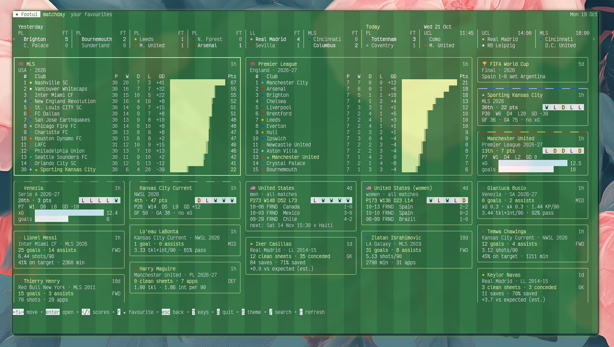
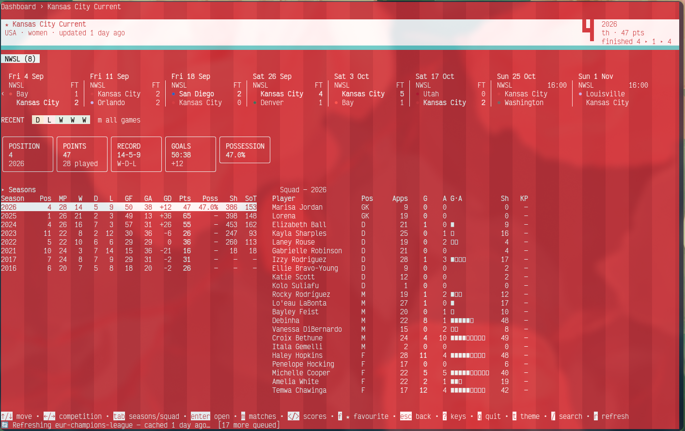

<h1 align="center">⚽ footui</h1>

<p align="center">
  <strong>Football stats you can drill into, right in your terminal.</strong><br>
  Tables, xG, form, squads, careers and every match a nation plays —
  in your club's colours, from a database on your own machine.
</p>

<p align="center">
  <a href="https://github.com/JohnSBarden/footui/actions/workflows/ci.yml"></a>
  
  
  <a href="LICENSE"></a>
  <a href="https://ko-fi.com/johnnycashmoney"></a>
</p>

A terminal UI for football stats. footui downloads league, club, player and
match data into a local SQLite database, then lets you browse it: league
tables, club pages, player careers, recent games and box scores, xG where
the source has it, and national teams' full match records.

### Matchday Overview

<p align="center" width="100%">
     
    Matchday Overview
</p>

<p align="center" width="100%">
     
    Club Details
</p>

## Install

Requires Go 1.26 or newer.

```sh
go install github.com/JohnSBarden/footui/cmd/footui@latest
```

Or from a clone: `make static` builds `bin/footui`, and `make release`
cross-compiles for Linux and macOS into `dist/`. The binary is pure Go
with no other dependencies.

## Quick start

footui ships with no data. Either fetch some from the shell:

```sh
footui refresh --all    # current season of the big five, MLS, NWSL, WSL, World Cup, UCL, UEL
footui                  # open the TUI
```

or open `footui`, press `d` for the league catalog, tick the seasons you
want and press `enter`. Downloads run in the background.

After that, footui refreshes the leagues and teams you follow when you open
it, once their data is more than 6 hours old (`--stale-after` changes this,
`0` turns it off).

## Usage

```sh
footui                                   # dashboard of favourites, or browse
footui league premier                    # a league table
footui team arsenal                      # a club
footui team england                      # a national team ("england women" for the women's side)
footui player saka                       # a player's career
footui league world-cup                  # a tournament
```

Names match what you've downloaded, ignoring case and accents.

```sh
footui refresh                                     # Premier League, current season
footui refresh --competition esp-la-liga --years 3 # La Liga, last 3 seasons
footui refresh --competition world-cup --season 2022
footui refresh --team england                      # a nation's matches, this year and last
footui refresh --all --years 5 --dry-run           # show what would be fetched
footui refresh --all --max-age 24h                 # skip anything fetched in the last day
```

| Command | |
|---|---|
| `footui status` | What's downloaded and how fresh it is |
| `footui competitions` | Every competition and its ID |
| `footui colors` | Apply the curated club colours |
| `footui config` | Show settings (`init` writes a commented file, `path` prints its location) |
| `footui completion <shell>` | Shell completions |

Global flags: `--db PATH`, `--theme weak|strong`, `--no-color`,
`--stale-after D`, `--debug`.

## Keys

Every screen lists its keys at the bottom; `?` shows them all. The mouse
works too.

| Key | |
|---|---|
| `/` | Search |
| `enter` / `esc` | Open / back |
| `f` | Star the league, club, nation or player under the cursor |
| `r` | Refresh what's on screen |
| `d` | League catalog |
| `L` | Download log, beside any screen |
| `t` | Toggle theme |
| `<` `>` | Scroll the scores strip |
| `←` `→` | Change season, competition or year |
| `m` | A club's last 30 games, or a tournament's fixtures |
| `q` | Quit |

While typing in a search box, use the `ctrl+` versions (`ctrl+f`, `ctrl+r`,
`ctrl+g`, `ctrl+t`), or `tab` into the results.

## Coverage

Data comes from two sources. `footui competitions` lists every competition
with its source and how far back it goes.

| | understat.com | ESPN |
|---|---|---|
| Leagues | Premier League, La Liga, Bundesliga, Serie A, Ligue 1, Russian Premier League | MLS, USL Championship, Championship, La Liga 2, 2. Bundesliga, Serie B, Ligue 2, WSL, Liga F, Première Ligue, NWSL, Champions League, Europa League, Conference League, Women's Champions League |
| History | 2014-15 on | Mostly 2010-11 on |
| Team stats | Goals, points, xG, xGA, npxG, PPDA, expected points | Goals, points, possession, shots, corners, fouls, cards |
| Player stats | Minutes, goals, assists, shots, key passes, xG, xA | Goals, assists, shots, cards |
| Matches | Score, xG | Score, possession, shots, corners, fouls |

ESPN also provides per-player detail (minutes, clean sheets, saves,
tackles, passing) fetched when you open a player; domestic cups (FA Cup,
League Cup, Copa del Rey, DFB-Pokal, Coppa Italia, Coupe de France, U.S.
Open Cup) as club games; and international football: World Cup, Euros,
Copa América, Gold Cup, AFCON, Asian Cup, qualifiers, Nations Leagues,
friendlies, and the women's equivalents.

Club colours (`internal/colors/seed/teamcolors.yaml`) and honours
(`internal/trophies/seed/trophies.yaml`) are curated by hand. Corrections
welcome.

## Configuration

Optional, at `~/.config/footui/config.yaml` (or `$FOOTUI_CONFIG`):

```yaml
theme: weak          # weak | strong
accent: lime         # lime | #rrggbb | terminal
stale_after: 6h      # 0 disables refresh-on-open
db: ~/footui/footui.db
no_color: false
debug: false         # write a debug log for bug reports
```

Flags override environment variables (`FOOTUI_THEME`, `FOOTUI_ACCENT`,
`NO_COLOR`, `FOOTUI_DEBUG`), which override the file.

Found a bug? Run with `--debug` (or `FOOTUI_DEBUG=1`) and attach
`~/.local/state/footui/debug.log` to the issue. It records every request,
retry, rate-limit pause, migration and club or player match, and the log
panel (`L`) shows the same lines live.

The database lives at `$XDG_DATA_HOME/footui/footui.db`
(`~/.local/share/footui/footui.db` by default). For scheduled updates, run
`footui refresh --all --max-age 24h` from cron or a systemd timer.

## Development

```sh
make check   # gofmt, vet, staticcheck, go mod tidy, tests with -race
make cover   # coverage summary
make live    # fetch one real competition from each source and check it parses
```

Set `FOOTUI_HTTP_CACHE=/some/dir` to cache raw responses while developing.
Architecture and schema notes are in [`docs/architecture.md`](docs/architecture.md)
and [`docs/data-model.md`](docs/data-model.md).

## Data sources

footui uses [understat.com](https://understat.com) and ESPN's public
endpoints. It isn't affiliated with either. The endpoints are undocumented
and may change. Requests are rate-limited; please keep them that way.

## Support

If footui earns a place in your terminal, you can buy me a coffee on
[Ko-fi](https://ko-fi.com/johnnycashmoney). ☕

## License

[MIT](LICENSE). The data belongs to its providers.
